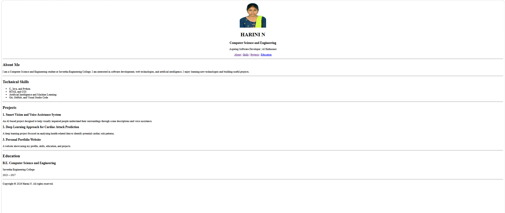

# Ex01 Portfolio
## Date:

## AIM
To create a Portfolio using HTML and CSS.

## ALGORITHM
### STEP 1
Create an HTML file (index.html)

### STEP 2
Create a CSS file (style.css)

### STEP 3
Include a navigation bar with links to different sections.

### STEP 4
Add structured sections for introduction, about, projects, and contact details.

### STEP 5
Define global styles for fonts, colors, and layout.

### STEP 6
Style the header, navigation bar, and sections.

### STEP 7
Use Flexbox or CSS Grid for layout design.

### STEP 8
Add hover effects and transitions for interactivity.

### STEP 9
Add Images and Media.

### STEP 10
Use optimized images for a professional look.

### STEP 11
Open the HTML file in a browser to check layout and functionality.

### STEP 12
Fix styling issues and refine content placement.

### STEP 13
Deploy the Portfolio.

### STEP 14
Upload to GitHub Pages for free hosting.

## PROGRAM
```

<!DOCTYPE html>
<html lang="en">
<head>
    <meta charset="UTF-8">
    <meta name="viewport" content="width=device-width, initial-scale=1.0">
    <title>Harini N | Portfolio</title>
</head>

<body>

    <header>
        <center>
            

            <h1>HARINI N</h1>
            <h3>Computer Science and Engineering</h3>
            <p>Aspiring Software Developer | AI Enthusiast</p>

            <p>
                <a href="#about">About</a> |
                <a href="#skills">Skills</a> |
                <a href="#projects">Projects</a> |
                <a href="#education">Education</a>
            </p>
        </center>
    </header>

    <hr>

    <main>
        <section id="about">
            <h2>About Me</h2>
            <p>
                I am a Computer Science and Engineering student at
                Saveetha Engineering College. I am interested in software
                development, web technologies, and artificial intelligence.
                I enjoy learning new technologies and building useful projects.
            </p>
        </section>

        <hr>

        <section id="skills">
            <h2>Technical Skills</h2>
            <ul>
                <li>C, Java, and Python</li>
                <li>HTML and CSS</li>
                <li>Artificial Intelligence and Machine Learning</li>
                <li>Git, GitHub, and Visual Studio Code</li>
            </ul>
        </section>

        <hr>

        <section id="projects">
            <h2>Projects</h2>

            <h3>1. Smart Vision and Voice Assistance System</h3>
            <p>
                An AI-based project designed to help visually impaired people
                understand their surroundings through scene descriptions
                and voice assistance.
            </p>

            <h3>2. Deep Learning Approach for Cardiac Attack Prediction</h3>
            <p>
                A deep learning project focused on analyzing health-related
                data to identify potential cardiac risk patterns.
            </p>

            <h3>3. Personal Portfolio Website</h3>
            <p>
                A website showcasing my profile, skills, education,
                and projects.
            </p>
        </section>

        <hr>

        <section id="education">
            <h2>Education</h2>
            <h3>B.E. Computer Science and Engineering</h3>
            <p>Saveetha Engineering College</p>
            <p>2023 – 2027</p>
        </section>
    </main>

    <hr>

    <footer>
        <p>Copyright &copy; 2026 Harini N. All rights reserved.</p>
    </footer>

</body>
</html>
```

## OUTPUT


## RESULT
The program for creating Portfolio using HTML and CSS is executed successfully.
